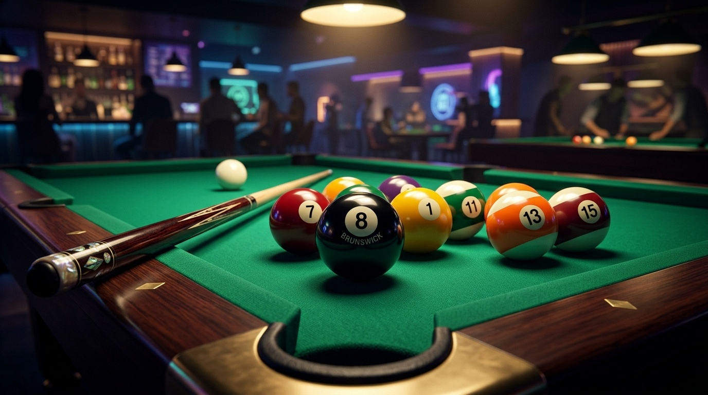

# 🎱 8-Ball Pool — Web Billiards Game

<p align="center">
  
</p>

<p align="center">
  <strong>A high-performance, responsive 8-Ball Pool web game built with Next.js 16, React 19, HTML5 Canvas, and a custom physics simulation engine.</strong>
</p>

<p align="center">
  
  
  
  
  
  
</p>

---

## ✨ Features

- **⚡ Custom 2D Physics Engine**: Hand-crafted continuous collision detection, elastic ball-to-ball collisions, cushion restitution, realistic rolling/sliding friction, and accurate 6-pocket drop mechanics.
- **🎯 Cue Spin & English Control**: Dedicated Spin modal allowing topspin (follow), backspin (draw), left/right english, affecting post-collision cue ball trajectories.
- **🤖 Smart AI Opponents**:
  - **Easy**: Casual play with wider aim margins.
  - **Medium**: Competitive positioning and consistent potting.
  - **Hard**: Calculated bank shots, combo shots, kick shots, and strategic defensive safety play.
- **👥 Multi-Mode Gameplay**:
  - **Solo vs Bot**: Test your skills against multiple bot difficulty levels.
  - **Pass & Play (2 Players)**: Local two-player multiplayer on a single device.
  - **Interactive Tutorial**: Step-by-step interactive training mode for beginners.
- **📱 Responsive & Orientation-Aware**: Seamless auto-resizing and canvas rotation between Portrait and Landscape modes across mobile, tablet, and desktop screens.
- **🌍 21 Languages Internationalization**: Full i18n support including English, Hindi, Spanish, French, German, Arabic, Japanese, Korean, Chinese, Russian, and more.
- **🔊 Immersive Audio FX**: Synthesized sound effects via Web Audio API for ball collisions, pocket sinks, cue strikes, and fouls.
- **🏆 Polished Modern UI**: Sleek HUD, ball rack status, turn timers, foul overlay alerts, ball-in-hand placement, and celebratory win modals with confetti.

---

## 🛠️ Tech Stack

- **Framework**: [Next.js 16](https://nextjs.org/) (App Router & Turbopack)
- **UI Library**: [React 19](https://react.dev/)
- **Language**: [TypeScript 5](https://www.typescriptlang.org/)
- **Styling**: [Tailwind CSS v4](https://tailwindcss.com/)
- **Icons**: [Lucide React](https://lucide.dev/)
- **Internationalization**: [next-intl](https://next-intl.dev/) / `use-intl`
- **Rendering**: HTML5 2D Canvas API

---

## 🚀 Getting Started

### Prerequisites

- [Node.js](https://nodejs.org/) (v18.18.0 or higher recommended)
- `npm`, `pnpm`, or `yarn`

### Installation

1. **Clone the repository:**
   ```bash
   git clone https://github.com/satyamkumar420/8-ball-pool.git
   cd 8-ball-pool
   ```

2. **Install dependencies:**
   ```bash
   npm install
   ```

3. **Start the local development server:**
   ```bash
   npm run dev
   ```

4. **Open in browser:**
   Navigate to [http://localhost:3000](http://localhost:3000).

---

## 🎮 How to Play

1. **Aiming**: Move mouse or drag touch screen to rotate cue stick around the cue ball.
2. **Fine-Tuning**: Use the fine-tune angle dial for pixel-perfect alignment.
3. **Spin (English)**: Click the Spin icon to place the cue tip impact point (top, bottom, left, right).
4. **Power & Strike**:
   - Pull back on the power meter slider or hold and release the strike trigger.
   - The longer you draw, the greater the shot velocity.
5. **Ball-in-Hand**: If an opponent commits a foul (scratch or illegal hit), drag the cue ball to any legal position on the table before shooting.

---

## 📂 Project Structure

```text
├── app/
│   ├── 8-ball-pool/
│   │   ├── components/
│   │   │   ├── game/          # GameCanvas, render loops, input listeners
│   │   │   └── ui/            # HUD, PowerMeter, SpinModal, FoulBanner, WinModal
│   │   ├── lib/
│   │   │   ├── constants/     # Ball specs, physics constants, bot configs
│   │   │   ├── engine/        # GameEngine & state management
│   │   │   ├── physics/       # Collision detection, ball dynamics, vector math
│   │   │   └── types/         # TypeScript definitions
│   │   └── utils/             # Sound synthesizer & helper utilities
│   ├── layout.tsx             # Root layout with meta tags & IntlProvider
│   └── page.tsx               # Main entry point
├── languages/                 # 21 localization JSON dictionaries
├── public/                    # Assets, avatars, sounds & README banner
└── package.json
```

---

## 📜 Scripts

| Command | Description |
| :--- | :--- |
| `npm run dev` | Starts local Next.js development server with hot-reload |
| `npm run build` | Compiles optimized production bundle |
| `npm run start` | Starts production server |
| `npm run lint` | Runs ESLint analysis across codebase |
| `npm run serve` | Builds static export and serves preview |

---

## 📄 License

This project is open source and available under the [MIT License](LICENSE).

---

<p align="center">
  Crafted with ❤️ by <a href="https://github.com/satyamkumar420">Satyam Kumar</a>
</p>
